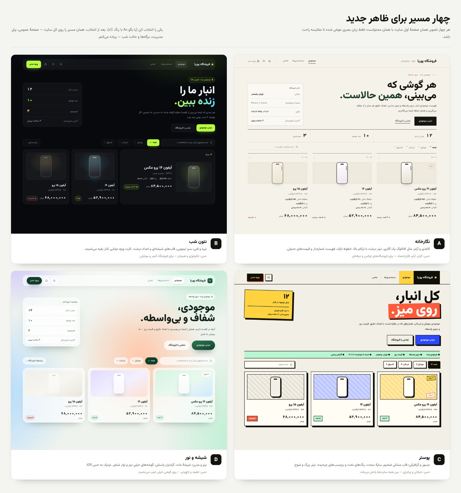
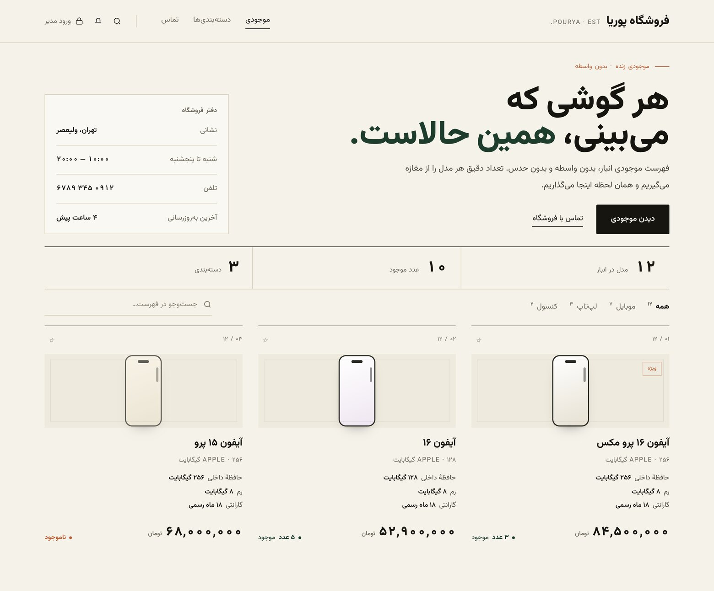
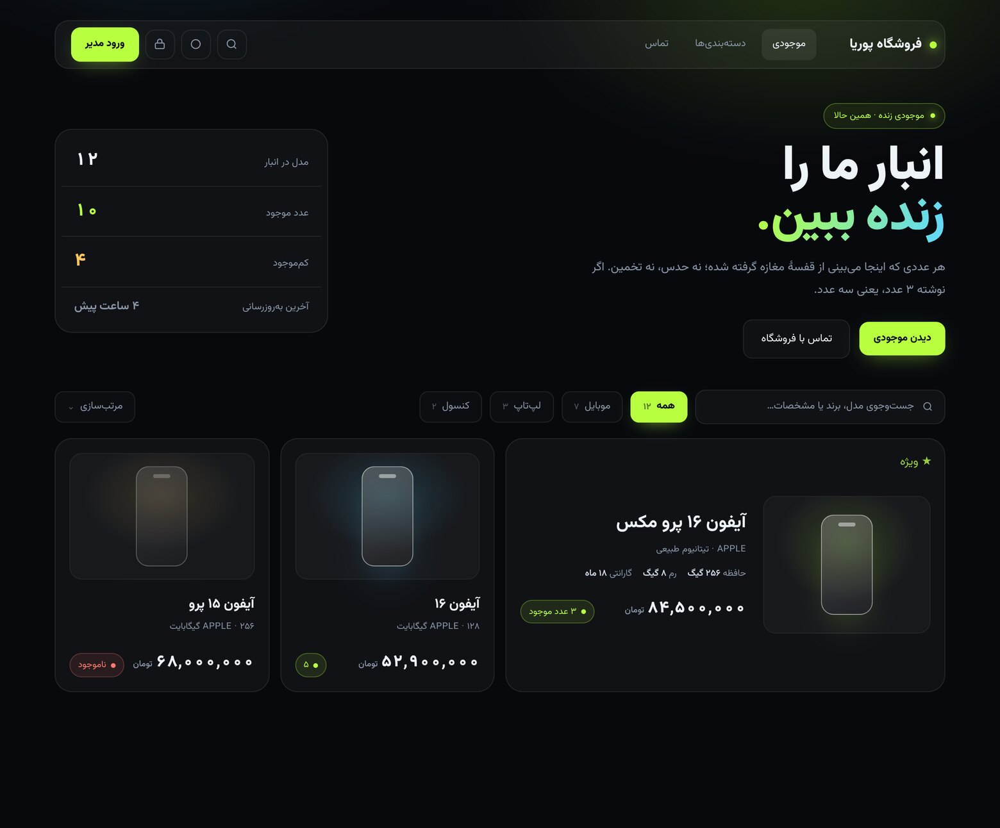
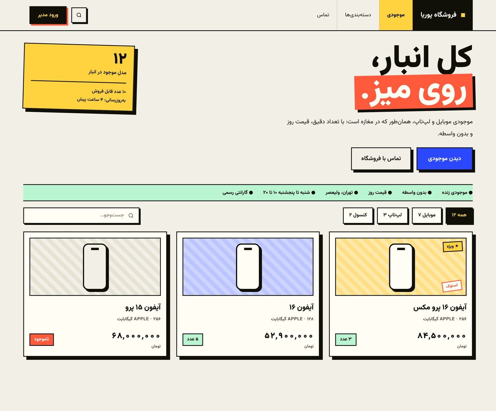
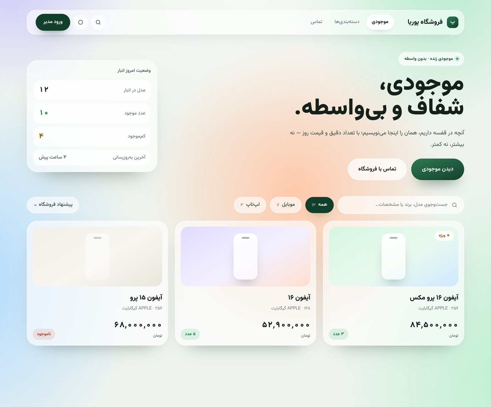

# چهار ایده برای ظاهر جدید

این‌ها فقط **ایده** هستند و هنوز روی سایت اعمال نشده‌اند. هر چهار تصویر همان صفحهٔ اول با همان محتواست؛ فقط زبان بصری عوض شده تا مقایسه راحت باشد.

---

## A — نگارخانه

کاغذی و آرام، مثل کاتالوگ یک گالری. تیتر درشت با تراکم بالا، خطوط نازک، فهرست شماره‌دار و قیمت‌های جدولی.
**حس:** گران، آرام، قابل‌اعتماد — برای فروشگاه‌های لوکس و حرفه‌ای.

---

## B — نئون شب

تیره و فنی؛ سبز لیمویی، قاب‌های شیشه‌ای و اعداد درشت. کارت ویژه دوتایی کنار بقیه می‌نشیند.
**حس:** تکنولوژی و هیجان — برای فروشگاه گیمر و موبایلی.

---

## C — پوستر

جسور و گرافیکی؛ قاب مشکی ضخیم، سایهٔ سخت، رنگ‌های تخت و برچسب‌های چرخیده. تیتر بزرگ و شوخ.
**حس:** خیابانی و پرانرژی — بین همه سایت‌ها یادش می‌ماند.

---

## D — شیشه و نور

نرم و مدرن؛ شیشهٔ مات، گرادیان پاستلی، گوشه‌های خیلی نرم و نوار شناور. نزدیک به حس iOS.
**حس:** لطیف و تاچ‌پذیر — روی گوشی خیلی خوب می‌نشیند.

---

**بعد از انتخاب:** همان مسیر روی کل سایت پیاده می‌شود — صفحهٔ عمومی، پنل مدیریت، برگه‌های فرم، حالت شب و صفحهٔ راهنما. ترکیب هم ممکن است («A با رنگ C»).
